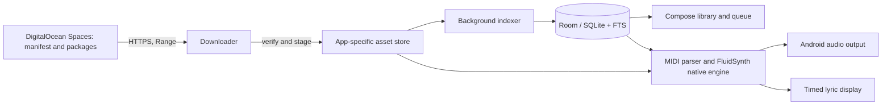

# JKTV Offline Karaoke — Android Architecture

## Product shape

The phone runs the catalog, singer queue, and playback locally. Cloudflare R2 distributes versioned library packages over HTTPS; it does not participate in playback. The Android install contains application code and the Room schema, while MIDI/KAR files and SoundFonts stay in app-specific storage.

## Modules

- **Compose app:** Home, Songs, Queue, Now Playing, Settings, first-run setup, and landscape lyrics presentation. The shared theme uses deep purple surfaces with violet and orange accents.
- **Catalog:** Room entities for songs, favorites, history, queue, and installed package versions. Room FTS indexes title and artist; a background indexer parses the source filename convention and MIDI headers.
- **Assets:** HTTPS manifest client, resumable package downloader, SHA-256 verifier, safe ZIP installer, atomic version activation, and persistent setup state. User initiated long transfers should use Android's user initiated data transfer API where supported, with a visible foreground notification and recoverable state.
- **Playback:** The app uses the `fluidsynth-kmp` Android package, which bundles FluidSynth native libraries for arm64-v8a, armeabi-v7a, and x86_64. `FluidSynthMidiEngine` loads the installed SF2 and local MIDI/KAR file, provides play/pause/seek, and tracks the parser's timed lyric events for the Now Playing screen.
- **Packager:** Developer tool reads only `songs/` plus the explicitly selected SoundFont, validates MIDI/SF2 headers, creates deterministic size-limited ZIPs, calculates SHA-256 and emits the manifest. DigitalOcean upload uses S3-compatible credentials from environment variables and a deliberate upload command.

## Data flow

## Deployment boundary

The default HTTPS manifest URL is the public R2 development endpoint for the JKTV library. It can be overridden at build time; no R2 credentials are embedded in the APK. Confirm redistribution rights before publishing MIDI/KAR files and SoundFonts.

## Implemented in this workspace

The initial project shell now includes the Compose navigation and setup screens, a Room catalog and queue, filename-based background indexing, FTS and fallback search, favorites, singer assignment, queue removal/reordering, MIDI timing/lyric event parsing, and an HTTPS package installer with resumable partial files, retries, SHA-256 checks, SF2 header validation, safe ZIP extraction, and staged activation. The developer packager validates local files, creates deterministic size-limited archives, writes a manifest and source index, can reuse unchanged package URLs from a prior manifest, and offers confirmation-gated Spaces uploads with remote checks.

The player and timed lyric display are integrated. Key/tempo adjustment, per-channel mixing, reverb/chorus controls, foreground transfer notifications, queue rotation, and automatic next-song playback remain unimplemented.

## Current environment limits

The project was built with Java 17, Gradle 8.11.1, and Android SDK Platform 35. Build commands use an ASCII temporary copy because Java/Room generated-source processing fails under the Japanese OneDrive path on this machine. Device playback has not been verified on a physical phone.
