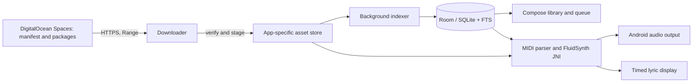

# JKTV Offline Karaoke — Android Architecture

## Product shape

The phone runs the catalog, singer queue, and playback locally. DigitalOcean Spaces distributes versioned library packages over HTTPS; it does not participate in playback. The Android install contains application code and the empty Room schema, while MIDI/KAR files and SoundFonts stay in app-specific storage.

## Modules

- **Compose app:** Home, Songs, Queue, Now Playing, Settings, first-run setup, and landscape lyrics presentation. The shared theme uses deep purple surfaces with violet and orange accents.
- **Catalog:** Room entities for songs, favorites, history, queue, and installed package versions. Room FTS indexes title and artist; a background indexer parses the source filename convention and MIDI headers.
- **Assets:** HTTPS manifest client, resumable package downloader, SHA-256 verifier, safe ZIP installer, atomic version activation, and persistent setup state. User initiated long transfers should use Android's user initiated data transfer API where supported, with a visible foreground notification and recoverable state.
- **Playback:** Kotlin playback service and a `MidiEngine` interface backed by a FluidSynth NDK/JNI build. The parser supplies tempo maps and timed lyric events; the engine owns audio output, seek, pause, transpose, tempo, channel volume, reverb, and chorus.
- **Packager:** Developer tool reads only `songs/` plus the explicitly selected SoundFont, validates MIDI/SF2 headers, creates deterministic size-limited ZIPs, calculates SHA-256 and emits the manifest. DigitalOcean upload uses S3-compatible credentials from environment variables and a deliberate upload command.

## Data flow

## Deployment boundary

No DigitalOcean endpoint, bucket, CDN URL, or credential configuration was found in the safe-to-read project configuration. Keep these as deployment inputs; never invent an endpoint or put credentials in the APK. The current source library contains 1,496 MIDI files in `songs/` and four SF2 files in `SoundFont/`. Confirm redistribution rights before publishing those files. The existing 3.6 MB APK is not assumed to be this native offline app.

## Implemented in this workspace

The initial project shell now includes the Compose navigation and setup screens, a Room catalog and queue, filename-based background indexing, FTS and fallback search, favorites, singer assignment, queue removal/reordering, MIDI timing/lyric event parsing, and an HTTPS package installer with resumable partial files, retries, SHA-256 checks, SF2 header validation, safe ZIP extraction, and staged activation. The developer packager validates local files, creates deterministic size-limited archives, writes a manifest and source index, can reuse unchanged package URLs from a prior manifest, and offers confirmation-gated Spaces uploads with remote checks.

The player interface is present only as a boundary contract: no FluidSynth JNI implementation is included. Foreground transfer notifications, cancel/pause controls, fuzzy search, queue rotation/automatic playback, and complete library version validation remain unimplemented. The UI exposes the current setup state instead of claiming those parts are ready.

## Current environment limits

This workspace did not contain an Android project before work began. Java, Gradle, Android SDK tools, Python, and the Python launcher are unavailable in this session. Source and build configuration can be prepared, but Gradle sync, APK creation, device tests, and visual device checks require an Android Studio/SDK environment. The source project remains read-only and untouched.
